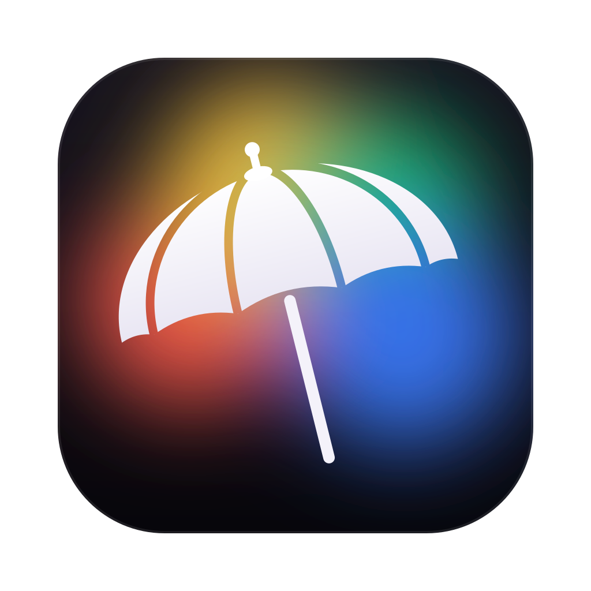

<p align="center"></p>

<h1 align="center">Frevo</h1>

<p align="center">Microfone com cancelamento de ruído e transcrição de chamadas para o Mac. Tudo roda no seu computador.</p>

O Frevo cria um microfone virtual chamado **Frevo**. Escolha ele no Meet, Zoom, Teams ou Slack e a outra ponta passa a ouvir só a sua voz: sem barulho de fundo, sem teclado, sem o eco do seu alto-falante. Se você quiser, ele também transcreve a chamada quando ela acaba, com o nome de quem falou cada coisa, e salva tudo em Markdown na sua pasta de Documentos.

- **Cancelamento de ruído** com o [DeepFilterNet3](https://github.com/Rikorose/DeepFilterNet), quadro a quadro (10 ms), gastando uns 3% de um núcleo.
- **Cancelamento do eco do alto-falante** com o cancelador do WebRTC: sem fone, quem está do outro lado não ouve a própria voz de volta.
- **Transcrição local** com o Whisper (large-v3-turbo), separando quem falou o quê. O Frevo aprende as vozes que você nomeia e reconhece essas pessoas nas próximas chamadas.
- **Ilha no notch** do MacBook: mostra se o filtro está limpando sua voz, se você está no mudo, se a chamada está sendo gravada e pergunta "Quem está falando?" para a transcrição sair com os nomes.
- **Nada vai para a nuvem.** O áudio, as transcrições e a memória de vozes ficam no seu Mac.

> O Frevo não é distribuído pela App Store nem assinado pela Apple. Você instala a partir do código, com um comando, e ele mesmo avisa quando sai versão nova. [Por que assim?](#por-que-compilar-no-próprio-mac)

## Requisitos

- Mac com **Apple Silicon** (M1 ou mais novo) e **macOS 15** ou mais novo.
- [Homebrew](https://brew.sh) instalado.
- Uns **5 GB livres**: ferramentas de compilação, bibliotecas e o modelo de transcrição.
- A senha de administrador do Mac, uma vez, para instalar o microfone virtual.

## Instalar

```bash
git clone https://github.com/JoaoPauloSMoura/frevo.git
cd frevo
scripts/instalar.sh
```

O instalador:

1. confere o Mac e instala o que faltar: as ferramentas de linha de comando da Apple e, pelo Homebrew, `rust`, `whisper-cpp`, `meson` e `ninja`;
2. baixa as bibliotecas e os modelos de voz nas versões testadas;
3. cria um certificado de assinatura só deste Mac, para as permissões não zerarem a cada atualização;
4. compila tudo, instala o driver do microfone virtual (pede a senha; o som do Mac corta por 1 ou 2 segundos) e abre o app.

Na primeira vez leva uns **10 a 15 minutos**. Rodar de novo é seguro: ele só refaz o que falta.

> Guarde a pasta `frevo`: o app se atualiza a partir dela. Se mover a pasta, rode `scripts/instalar.sh` de novo no lugar novo.

## Primeiros passos

1. **Libere as permissões** que o macOS pedir. Cada uma serve para uma coisa:

   | Permissão | Para quê | Sem ela |
   |---|---|---|
   | Microfone | Ler o seu microfone de verdade para limpar a voz | O Frevo não funciona |
   | Gravação de áudio do sistema | Ouvir o som da chamada: para tirar o eco do alto-falante e para transcrever a voz dos outros | Sem cancelamento de eco e sem a voz dos outros na transcrição |
   | Acessibilidade | Ler o botão de mudo do Meet, Zoom, Teams e Slack | O que você fala no mudo pode entrar na transcrição |
   | Calendário | Dar à transcrição o nome do evento e sugerir os convidados como nomes | A transcrição fica como "Chamada 14h30" |
   | Automação (Chrome, Safari…) | Ler o endereço da aba do Meet, para achar o evento certo da agenda | O nome da reunião vem só pelo horário |
   | Notificações | Avisar que a transcrição ficou pronta e que há versão nova | Nada além disso |

2. **No app de chamada, escolha "Frevo" como microfone** (Meet: ⚙︎ → Áudio; Zoom: Configurações → Áudio; Teams: Configurações → Dispositivos).

Pronto. A sombrinha fica na barra de menu. Fora de chamada, o Frevo não abre o seu microfone: ele só liga quando um app de chamada abre o "Frevo".

## Usar

### Painel da barra de menu

Clique na sombrinha. O painel mostra:
- a onda do seu microfone: cinza é o que o microfone ouviu, verde é o que sai depois do filtro;
- quanto ruído está sendo tirado;
- os interruptores de filtro e de transcrição;
- as próximas reuniões da agenda, com o botão **Entrar**;
- as transcrições recentes.

Na engrenagem ficam os ajustes:

- **Microfone:** "Automático" prefere o microfone padrão do Mac, depois headset USB, Bluetooth e o do próprio Mac.
- **Transcrever chamadas por padrão.**
- **Cancelar o eco do alto-falante:** ligado por padrão. Com fone, ele não tem o que tirar e deixa a voz passar igual.
- **Perguntar na ilha quem está falando.**
- **Abrir ao iniciar o Mac.**
- **Procurar atualizações** e a versão instalada.

Os ícones da barra de menu: a sombrinha simples quer dizer tudo certo. Com um ponto, a chamada está sendo gravada para transcrever. Riscada, o filtro está desligado.

### Ilha no notch

Nos MacBooks com notch, o Frevo desenha uma "ilha" em volta dele durante as chamadas:
- **Lado esquerdo:** barrinhas verdes que pulam com a sua voz limpa, ou um microfone laranja quando você está no mudo.
- **Lado direito:** o ponto vermelho com o tempo de gravação, ou um anel cinza com o tempo da chamada quando ela não está sendo gravada.

Passe o mouse para abrir a ilha com a onda e os atalhos. No começo de cada chamada, ela abre sozinha por alguns segundos com o interruptor de transcrever. Sem notch (monitor externo, tampa fechada), aparece um aviso no lugar.

### Transcrição

Quando uma chamada começa, você decide se ela vai ser transcrita: pelo interruptor na ilha ou no painel, ou deixando "Transcrever chamadas por padrão" ligado.

- **Ligou no meio?** O começo entra junto. Sem transcrição, o Frevo guarda só na memória os últimos 15 minutos da chamada, sem gravar nada em disco. Se você não ligar, isso é descartado quando a chamada acaba.
- **Quando a chamada termina**, o Frevo transcreve no próprio Mac. A primeira vez baixa o modelo do Whisper (1,6 GB, uma vez só). Uma reunião de 1 hora leva uns 8 minutos.
- **O arquivo** vai para `~/Documents/Ligações/ano/mês/dia/Nome da reunião.md`, com o nome de cada pessoa e o horário de cada fala.
- **No mudo:** o que o seu microfone ouve enquanto você está no mudo do app de chamada não entra na transcrição.

**Quem falou.** O Frevo separa as vozes da chamada e tenta dar nome a cada uma:

- **Memória de vozes:** quem você já nomeou numa chamada é reconhecido sozinho nas próximas.
- **Pergunta na ilha:** quando uma voz nova fala por uns 6 segundos, a ilha pergunta "Quem está falando?", com os convidados do evento como botões. Se a memória tiver um palpite, pergunta "Quem está falando é Fulano?". É uma pergunta por pessoa, com intervalo de pelo menos 30 segundos entre elas.
- **Quem foi chamado e respondeu:** se alguém diz "…, Marina?" e logo outra voz responde, essa voz provavelmente é a Marina. O Frevo junta essas pistas e preenche sugestões.
- **Convidados:** com o evento da agenda, o Frevo sabe quantas pessoas podem estar na chamada. Ele junta vozes parecidas demais (a mesma pessoa partida em duas) e avisa quando falou alguém fora do convite.
- **Janela "Quem falou?":** o que ficar sem nome aparece numa janela no fim. Dá para ouvir um trecho de cada voz e confirmar ou corrigir as sugestões. Com isso, o Frevo aprende as vozes.

O áudio de uma chamada fica guardado só até todas as vozes terem nome, ou por no máximo 7 dias. Depois é apagado, e fica só o texto.

## Atualizações

Quando sai versão nova, o Frevo avisa com uma notificação e com um cartão no painel: **Nova versão: v0.3.0**, com as novidades e o botão **Atualizar**. Ele confere ao abrir e a cada 6 horas. Dá para conferir na hora em Ajustes → Procurar atualizações.

O botão **Atualizar**:
- baixa o código novo na pasta onde você instalou;
- recompila só o que mudou (1 a 2 minutos);
- espera a chamada acabar, se houver uma;
- fecha e abre o Frevo já atualizado.

Se a versão nova mudar o driver do microfone virtual, o macOS pede a senha de administrador.

Pelo terminal, dá no mesmo:

```bash
scripts/atualizar.sh            # versão mais nova
scripts/atualizar.sh v0.2.0     # uma versão específica
```

O registro de cada atualização fica em `~/Library/Logs/Frevo/atualizacao.log`.

### Por que compilar no próprio Mac

Para um app baixado da internet abrir sem avisos, a Apple exige um certificado pago de desenvolvedor e uma notarização. O Frevo evita isso: cada pessoa compila no próprio Mac, e o macOS não bloqueia o que você mesmo compilou.

O instalador também cria um certificado de assinatura local ("Frevo (assinatura local)", guardado no seu Chaveiro). O macOS prende as permissões à assinatura do app. Assinando sempre com o mesmo certificado, Acessibilidade e gravação de áudio continuam liberadas depois de cada atualização. Esse certificado não sai do seu Mac e não serve para assinar nada além do Frevo que você compila.

## Privacidade

- Tudo é processado no Mac. O Frevo só usa a internet para:
  - baixar os modelos na instalação, do GitHub e do Hugging Face;
  - baixar o Whisper na primeira transcrição;
  - procurar versões novas no GitHub (`git fetch`).
- **O que fica guardado:**
  - **Transcrições:** em `~/Documents/Ligações`.
  - **Modelo do Whisper, memória de vozes e o áudio das chamadas com vozes ainda sem nome:** em `~/Library/Application Support/Frevo`.
- **Impressão de voz é dado biométrico** (LGPD), e transcrever uma chamada envolve dados pessoais de quem está nela. Avise os participantes antes de transcrever, e siga a política da sua empresa.

## Desinstalar

```bash
scripts/desinstalar.sh          # tira o app, o driver e o certificado local
scripts/desinstalar.sh --tudo   # e também a memória de vozes, o modelo do Whisper e os ajustes (pergunta antes)
```

As transcrições em `~/Documents/Ligações` nunca são apagadas.

## Problemas comuns

**O "Frevo" não aparece na lista de microfones.**
O driver não está instalado ou o serviço de áudio não recarregou. Rode `scripts/instalar-driver.sh` (pede a senha) e reabra o app de chamada.

**O macOS pede as permissões de novo depois de atualizar.**
O app foi assinado sem o certificado local. Rode `scripts/criar-certificado.sh` e depois `scripts/atualizar.sh`. Libere as permissões uma última vez.

**O mudo não é reconhecido.**
- Confira se o Frevo está liberado em Ajustes do Sistema → Privacidade e Segurança → Acessibilidade.
- No Slack, o botão de mudo só existe na janela do huddle, não na barra lateral.
- O WhatsApp para Mac não deixa ler o botão.

**A outra ponta ouve a própria voz.**
Confira se "Cancelar o eco do alto-falante" está ligado e se o Frevo tem a permissão de gravação de áudio do sistema. Com fone, não há eco.

**A transcrição não começou depois da chamada.**
Ela só roda se a chamada foi gravada (ponto vermelho na ilha) e durou mais de 20 segundos. O progresso aparece no painel.

**A atualização falhou.**
O motivo está em `~/Library/Logs/Frevo/atualizacao.log`. Se você mexeu no código da pasta, o atualizador não sobrescreve suas mudanças: guarde-as (`git stash`) e rode `scripts/atualizar.sh`.

## Como funciona

```
Som que o Mac toca (captura do sistema) ─┐ referência
Microfone → cancelador de eco (WebRTC AEC3) → DeepFilterNet3 (10 ms por quadro) → Frevo Feed (oculto)
                                                                                         ↓ driver
                                                          Meet / Zoom / Teams / Slack ← Frevo
```

- **Microfone virtual:** um driver de áudio (AudioServerPlugIn) cria dois dispositivos ligados entre si: "Frevo Feed", oculto, onde o app escreve a voz limpa, e "Frevo", o microfone que os apps de chamada leem.
- **Transcrição:** junta a sua voz, que já sai limpa do filtro, com o som do app da chamada, capturado por um *process tap* do macOS.
  - O Whisper transcreve a conversa inteira.
  - O pyannote marca as trocas de voz.
  - O ERes2NetV2 tira a impressão de voz de cada pessoa.

Detalhes, medições e como compilar cada parte: [docs/DESENVOLVIMENTO.md](docs/DESENVOLVIMENTO.md).

## Créditos

O Frevo existe graças a estes projetos de código aberto:

| Projeto | Para quê | Licença |
|---|---|---|
| [DeepFilterNet](https://github.com/Rikorose/DeepFilterNet) | Cancelamento de ruído (modelo DeepFilterNet3) | MIT / Apache-2.0 |
| [webrtc-audio-processing](https://gitlab.freedesktop.org/pulseaudio/webrtc-audio-processing) | Cancelamento de eco (AEC3) | BSD-3-Clause |
| [libASPL](https://github.com/gavv/libASPL) | Driver de áudio virtual | MIT |
| [whisper.cpp](https://github.com/ggml-org/whisper.cpp) e [Whisper](https://github.com/openai/whisper) | Transcrição | MIT |
| [sherpa-onnx](https://github.com/k2-fsa/sherpa-onnx) | Separação e impressão de vozes | Apache-2.0 |
| [pyannote segmentation 3.0](https://huggingface.co/pyannote/segmentation-3.0) | Trocas de voz | MIT |
| [3D-Speaker ERes2NetV2](https://github.com/modelscope/3D-Speaker) | Impressão de voz | Apache-2.0 |
| [CED](https://github.com/RicherMans/CED) | Separar fala de música e outros sons | Apache-2.0 |

## Licença

[MIT](LICENSE) © 2026 João Paulo S. Moura
