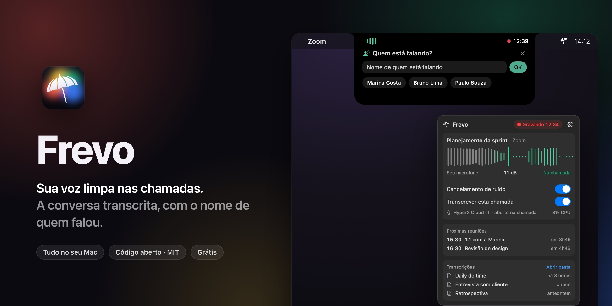
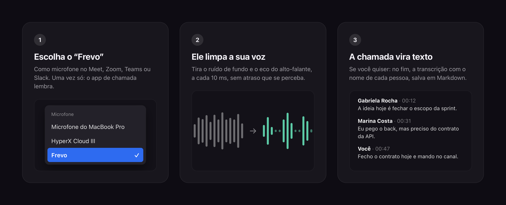
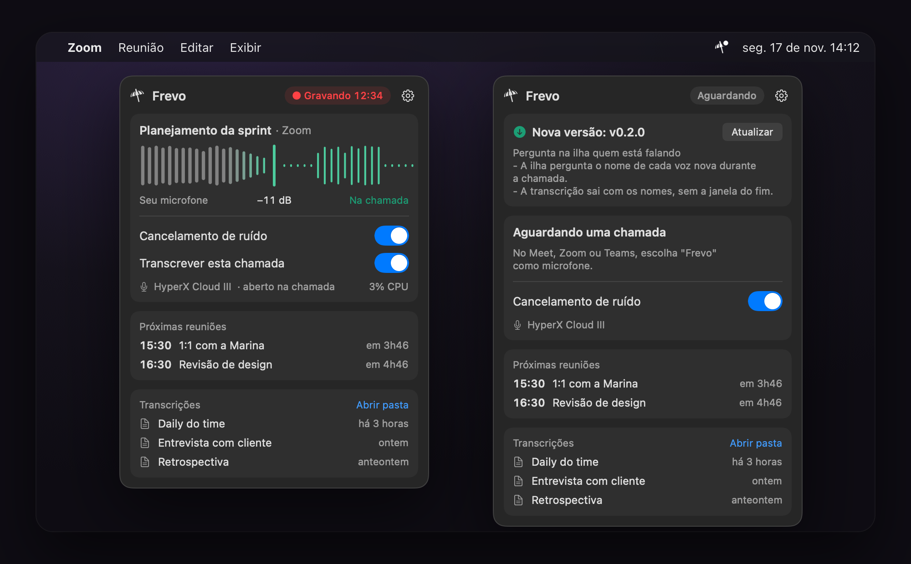
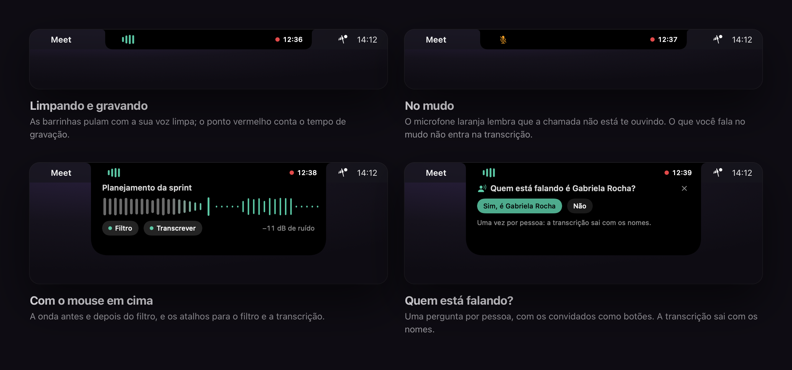
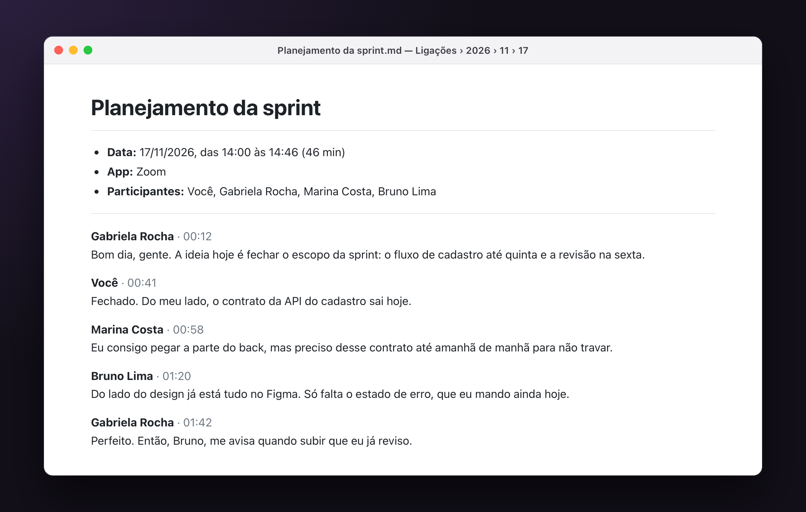
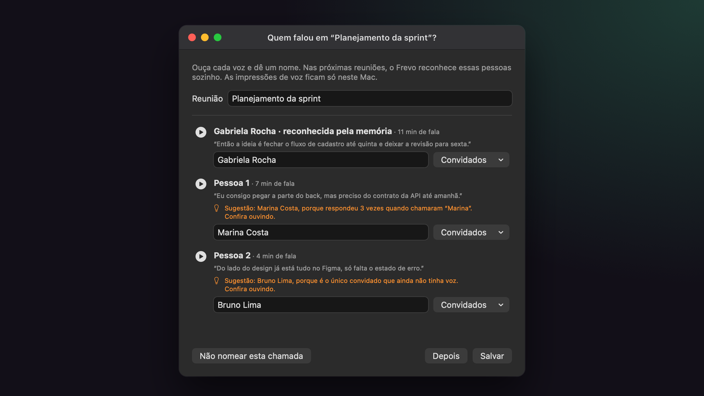
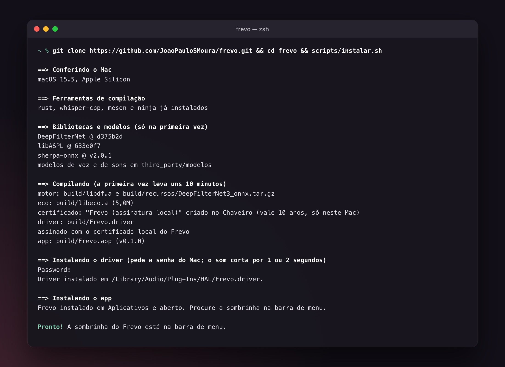

<p align="center">
  
</p>

<p align="center">
  Microfone com cancelamento de ruído e transcrição de chamadas para o Mac.<br>
  Escolha "Frevo" como microfone no Meet, Zoom, Teams ou Slack, e a outra ponta ouve só a sua voz.
</p>

<p align="center">
  <a href="https://github.com/JoaoPauloSMoura/frevo/releases/latest"></a>
  
  
  <a href="LICENSE"></a>
</p>

<p align="center">
  <a href="#instalar">Instalar</a> ·
  <a href="#tudo-o-que-ele-faz">Funções</a> ·
  <a href="#frevo-e-krisp-lado-a-lado">Frevo e Krisp</a> ·
  <a href="#privacidade">Privacidade</a> ·
  <a href="#problemas-comuns">Problemas comuns</a> ·
  <a href="docs/DESENVOLVIMENTO.md">Desenvolvimento</a>
</p>

## Por que o Frevo

**Grátis, sem limite de minutos.** O Frevo é de código aberto (MIT). Não tem plano, assinatura nem cota de transcrição. Uma pessoa ou um time inteiro paga o mesmo: nada.

**Nada sai do seu Mac.** O filtro, o cancelamento de eco, a transcrição e a memória de vozes rodam no seu computador. As transcrições são arquivos Markdown na sua pasta de Documentos, e não ficam na nuvem de ninguém.

**A transcrição sabe quem falou.** O Frevo separa as vozes da chamada, aprende quem é quem e, durante a chamada, pergunta na ilha do notch "Quem está falando?". A transcrição sai com o nome de cada pessoa.

**Feito para chamada de verdade.**
- Tira o eco do alto-falante, para quem está sem fone.
- Lê o botão de mudo do Meet, Zoom, Teams e Slack.
- Pega o nome da reunião e os convidados na sua agenda.
- Transcreve desde o começo mesmo se você ligar a transcrição no meio.

**Atualiza sozinho.** Quando sai versão nova, o Frevo avisa e se atualiza com um clique, sem conta de desenvolvedor da Apple nem App Store.

## Como funciona

<p align="center">
  
</p>

## Tudo o que ele faz

### Sua voz limpa, sem eco

O Frevo lê o seu microfone de verdade e tira o ruído de fundo com o [DeepFilterNet3](https://github.com/Rikorose/DeepFilterNet), quadro a quadro, a cada 10 ms: teclado, ventilador, obra no vizinho, cachorro. Antes, o cancelador de eco do WebRTC tira a voz dos outros que volta pelo alto-falante. A voz limpa sai num microfone virtual chamado **Frevo**.

O painel da barra de menu mostra a onda antes (cinza) e depois do filtro (verde), quanto ruído está saindo, os interruptores de filtro e de transcrição, as próximas reuniões da agenda e as transcrições recentes. Gasta uns 3% de um núcleo.



<p align="center"><sub>As pessoas, reuniões e conversas nas imagens são inventadas.</sub></p>

### Uma ilha no notch

Nos MacBooks com notch, o Frevo desenha uma ilha em volta dele durante a chamada:
- barrinhas que pulam com a sua voz limpa;
- o ponto vermelho com o tempo de gravação;
- um microfone laranja quando você está no mudo.

Com o mouse em cima, ela abre com a onda e os atalhos. Sem notch (monitor externo, tampa fechada), aparece um aviso no lugar.



### A chamada transcrita, com os nomes

Ligue a transcrição pela ilha ou pelo painel, ou deixe ligada por padrão. Quando a chamada acaba, o Whisper (large-v3-turbo) transcreve no próprio Mac. Uma reunião de 1 hora leva uns 8 minutos.

- O arquivo vai para `~/Documents/Ligações/ano/mês/dia/`, com o nome do evento da agenda, os participantes e o horário de cada fala.
- O que o seu microfone ouve enquanto você está no mudo não entra na transcrição.
- Ligou a transcrição no meio da chamada? O começo entra junto. Sem transcrição, o Frevo guarda só na memória os últimos 15 minutos, sem gravar nada em disco, e descarta tudo se você não ligar.



### Quem está falando?

O Frevo separa as vozes da chamada (pyannote + ERes2NetV2) e junta as pistas para dar nome a cada uma:

- **Memória de vozes:** quem você já nomeou é reconhecido sozinho nas próximas chamadas.
- **Pergunta na ilha:** quando uma voz nova fala por uns 6 segundos, a ilha pergunta quem é, com os convidados do evento como botões. É uma pergunta por pessoa.
- **Quem foi chamado e respondeu:** se alguém diz "…, Marina?" e logo outra voz responde, essa voz provavelmente é a Marina.
- **Convidados:** o convite diz quantas pessoas podem estar na chamada. O Frevo junta vozes que são a mesma pessoa partida em duas e avisa quando falou alguém fora do convite.

O que ficar sem nome aparece numa janela no fim, com as sugestões já preenchidas e o motivo de cada uma. Dá para ouvir um trecho de cada voz antes de confirmar.



### Atualiza sozinho

O Frevo confere se há versão nova ao abrir e a cada 6 horas. Quando há, avisa com uma notificação e com um cartão no painel (o da direita, na imagem do painel acima), com as novidades e o botão **Atualizar**.

O botão:
- baixa o código novo;
- recompila só o que mudou, em 1 ou 2 minutos;
- espera a chamada acabar, se houver uma;
- fecha e abre o Frevo já atualizado.

## Frevo e Krisp, lado a lado

O Krisp faz mais, e cobra por usuário. O Frevo faz bem o dia a dia de quem vive em chamada, e roda inteiro no seu Mac. Preços e funções do Krisp são os que aparecem em [krisp.ai/pricing](https://krisp.ai/pricing/) e [krisp.ai/noise-cancellation](https://krisp.ai/noise-cancellation/) em novembro de 2026, em dólar.

|  | Frevo | Krisp (Meeting AI) |
|---|---|---|
| **Preço** | Grátis, código aberto (MIT) | Core: US$ 8 por usuário por mês no plano anual (US$ 16 no mensal). Advanced: US$ 15 (US$ 30 no mensal). Teste grátis de 7 dias |
| **Cancelamento de ruído** | ✅ no Mac, sem limite | ✅ no aparelho, sem limite |
| **Cancelamento de eco** | ✅ eco do alto-falante | ✅ eco da sala |
| **Transcrição** | ✅ sem limite, no Mac | ✅ sem limite |
| **Onde ficam as transcrições** | No seu Mac, em Markdown | Na nuvem do Krisp (10 GB no Core, 60 GB no Advanced). No aparelho, só no plano Enterprise, sob consulta |
| **Nome de quem falou** | ✅ memória de vozes, pergunta na ilha e sugestões pelos convidados | Não consta nas páginas consultadas |
| **Leitura do mudo do app de chamada** | ✅ Meet, Zoom, Teams e Slack | Não consta nas páginas consultadas |
| **Código** | Aberto | Fechado |

### Onde o Krisp faz mais

|  | Frevo | Krisp |
|---|---|---|
| **Resumo e próximos passos com IA** | Ainda não | ✅ notas e itens de ação |
| **Gravação de áudio e vídeo** | Só o áudio, até as vozes terem nome (no máximo 7 dias) | ✅ áudio e vídeo |
| **Windows e celular** | Só Mac com Apple Silicon | ✅ Mac e Windows, e app de celular |
| **Instalação** | Compila no seu Mac, com um comando (uns 15 minutos na primeira vez) | Instalador pronto |

## Instalar

Você precisa de:
- um Mac com **Apple Silicon** (M1 ou mais novo) e **macOS 15** ou mais novo;
- o [Homebrew](https://brew.sh) instalado;
- uns **5 GB livres**;
- a senha de administrador do Mac, uma vez.

```bash
git clone https://github.com/JoaoPauloSMoura/frevo.git
cd frevo
scripts/instalar.sh
```



O instalador:
1. confere o Mac e instala o que faltar: as ferramentas de linha de comando da Apple e, pelo Homebrew, `rust`, `whisper-cpp`, `meson` e `ninja`;
2. baixa as bibliotecas e os modelos nas versões testadas;
3. cria um certificado de assinatura só deste Mac, para as permissões não zerarem a cada atualização;
4. compila tudo, instala o driver do microfone virtual (pede a senha; o som do Mac corta por 1 ou 2 segundos) e abre o app.

Na primeira vez leva uns **10 a 15 minutos**. Rodar de novo é seguro: ele só refaz o que falta.

> Guarde a pasta `frevo`: o app se atualiza a partir dela. Se mover a pasta, rode `scripts/instalar.sh` de novo no lugar novo.

### Por que compilar no próprio Mac

Para um app baixado da internet abrir sem avisos, a Apple exige um certificado pago de desenvolvedor e uma notarização. O Frevo evita isso: cada pessoa compila no próprio Mac, e o macOS não bloqueia o que você mesmo compilou.

O certificado local ("Frevo (assinatura local)", no seu Chaveiro) resolve o outro lado. O macOS prende as permissões à assinatura do app. Assinando sempre com o mesmo certificado, Acessibilidade e gravação de áudio continuam liberadas depois de cada atualização. Esse certificado não sai do seu Mac e só assina o Frevo que você compila.

## Primeiros passos

**1. Libere as permissões** que o macOS pedir:

| Permissão | Para quê | Sem ela |
|---|---|---|
| Microfone | Ler o seu microfone de verdade para limpar a voz | O Frevo não funciona |
| Gravação de áudio do sistema | Ouvir o som da chamada: para tirar o eco do alto-falante e transcrever a voz dos outros | Sem cancelamento de eco e sem a voz dos outros na transcrição |
| Acessibilidade | Ler o botão de mudo do Meet, Zoom, Teams e Slack | O que você fala no mudo pode entrar na transcrição |
| Calendário | Dar à transcrição o nome do evento e sugerir os convidados como nomes | A transcrição fica como "Chamada 14h30" |
| Automação (Chrome, Safari…) | Ler o endereço da aba do Meet, para achar o evento certo da agenda | O nome da reunião vem só pelo horário |
| Notificações | Avisar que a transcrição ficou pronta e que há versão nova | Nada além disso |

**2. No app de chamada, escolha "Frevo" como microfone.** No Meet: ⚙︎ → Áudio. No Zoom: Configurações → Áudio. No Teams: Configurações → Dispositivos.

Pronto. Fora de chamada, o Frevo não abre o seu microfone: ele só liga quando um app de chamada abre o "Frevo".

## Ajustes

Na engrenagem do painel:

- **Microfone:** "Automático" prefere o microfone padrão do Mac, depois headset USB, Bluetooth e o do próprio Mac.
- **Transcrever chamadas por padrão.**
- **Cancelar o eco do alto-falante:** ligado por padrão. Com fone não há eco, e a voz passa igual.
- **Perguntar na ilha quem está falando.**
- **Abrir ao iniciar o Mac.**
- **Procurar atualizações** e a versão instalada.

Na barra de menu, a sombrinha simples quer dizer tudo certo. Com um ponto, a chamada está sendo gravada para transcrever. Riscada, o filtro está desligado.

## Atualizações

O botão **Atualizar** do painel faz tudo. Pelo terminal, dá no mesmo:

```bash
scripts/atualizar.sh            # versão mais nova
scripts/atualizar.sh v0.2.0     # uma versão específica
```

Se a versão nova mudar o driver do microfone virtual, o macOS pede a senha de administrador. O registro de cada atualização fica em `~/Library/Logs/Frevo/atualizacao.log`.

## Privacidade

- Tudo é processado no Mac. O Frevo só usa a internet para:
  - baixar os modelos na instalação, do GitHub e do Hugging Face;
  - baixar o Whisper na primeira transcrição;
  - procurar versões novas no GitHub (`git fetch`).
- **O que fica guardado:**
  - **Transcrições:** em `~/Documents/Ligações`.
  - **Modelo do Whisper e memória de vozes:** em `~/Library/Application Support/Frevo`.
  - **Áudio das chamadas com vozes ainda sem nome:** também em `~/Library/Application Support/Frevo`, até todas as vozes terem nome ou por no máximo 7 dias.
- **Impressão de voz é dado biométrico** (LGPD), e transcrever uma chamada envolve dados pessoais de quem está nela. Avise os participantes antes de transcrever, e siga a política da sua empresa.

## Desinstalar

```bash
scripts/desinstalar.sh          # tira o app, o driver e o certificado local
scripts/desinstalar.sh --tudo   # e também a memória de vozes, o modelo do Whisper e os ajustes (pergunta antes)
```

As transcrições em `~/Documents/Ligações` nunca são apagadas.

## Problemas comuns

**O "Frevo" não aparece na lista de microfones.**
O driver não está instalado ou o serviço de áudio não recarregou. Rode `scripts/instalar-driver.sh` (pede a senha) e reabra o app de chamada.

**O macOS pede as permissões de novo depois de atualizar.**
O app foi assinado sem o certificado local. Rode `scripts/criar-certificado.sh` e depois `scripts/atualizar.sh`. Libere as permissões uma última vez.

**O mudo não é reconhecido.**
- Confira se o Frevo está liberado em Ajustes do Sistema → Privacidade e Segurança → Acessibilidade.
- No Slack, o botão de mudo só existe na janela do huddle, não na barra lateral.
- O WhatsApp para Mac não deixa ler o botão.

**A outra ponta ouve a própria voz.**
Confira se "Cancelar o eco do alto-falante" está ligado e se o Frevo tem a permissão de gravação de áudio do sistema.

**A transcrição não começou depois da chamada.**
Ela só roda se a chamada foi gravada (ponto vermelho na ilha) e durou mais de 20 segundos. O progresso aparece no painel.

**A atualização falhou.**
O motivo está em `~/Library/Logs/Frevo/atualizacao.log`. Se você mexeu no código da pasta, o atualizador não sobrescreve suas mudanças: guarde-as (`git stash`) e rode `scripts/atualizar.sh`.

## Por dentro

```
Som que o Mac toca (captura do sistema) ─┐ referência
Microfone → cancelador de eco (WebRTC AEC3) → DeepFilterNet3 (10 ms por quadro) → Frevo Feed (oculto)
                                                                                         ↓ driver
                                                          Meet / Zoom / Teams / Slack ← Frevo
```

- **Microfone virtual:** um driver de áudio (AudioServerPlugIn) cria dois dispositivos ligados entre si: "Frevo Feed", oculto, onde o app escreve a voz limpa, e "Frevo", que os apps de chamada leem.
- **Transcrição:** junta a sua voz, que já sai limpa do filtro, com o som do app da chamada, capturado por um *process tap* do macOS.
  - O Whisper transcreve a conversa inteira.
  - O pyannote marca as trocas de voz.
  - O ERes2NetV2 tira a impressão de voz de cada pessoa.

Como o código está organizado, as ferramentas de teste e as medições que guiaram cada escolha: [docs/DESENVOLVIMENTO.md](docs/DESENVOLVIMENTO.md). Para soltar uma versão: [docs/VERSOES.md](docs/VERSOES.md).

## Créditos

O Frevo existe graças a estes projetos de código aberto:

| Projeto | Para quê | Licença |
|---|---|---|
| [DeepFilterNet](https://github.com/Rikorose/DeepFilterNet) | Cancelamento de ruído (modelo DeepFilterNet3) | MIT / Apache-2.0 |
| [webrtc-audio-processing](https://gitlab.freedesktop.org/pulseaudio/webrtc-audio-processing) | Cancelamento de eco (AEC3) | BSD-3-Clause |
| [libASPL](https://github.com/gavv/libASPL) | Driver de áudio virtual | MIT |
| [whisper.cpp](https://github.com/ggml-org/whisper.cpp) e [Whisper](https://github.com/openai/whisper) | Transcrição | MIT |
| [sherpa-onnx](https://github.com/k2-fsa/sherpa-onnx) | Separação e impressão de vozes | Apache-2.0 |
| [pyannote segmentation 3.0](https://huggingface.co/pyannote/segmentation-3.0) | Trocas de voz | MIT |
| [3D-Speaker ERes2NetV2](https://github.com/modelscope/3D-Speaker) | Impressão de voz | Apache-2.0 |
| [CED](https://github.com/RicherMans/CED) | Separar fala de música e outros sons | Apache-2.0 |

## Licença

[MIT](LICENSE) © 2026 João Paulo S. Moura
